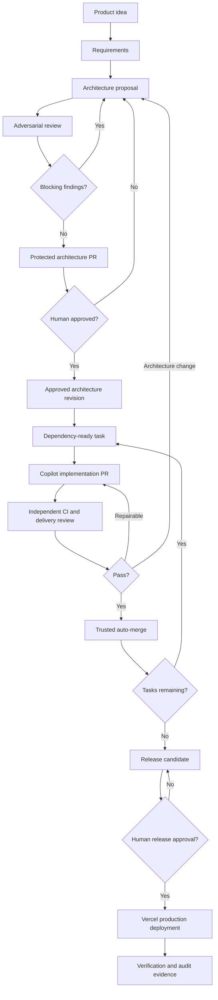

# Agentic Delivery Framework

A GitHub-native, governed software delivery system that turns a product idea into a reviewed architecture and incrementally implements that architecture in an existing Vercel-compatible web application.

**Operating principle:** humans authorize consequential decisions; agents perform approved work; independent platform controls enforce the boundaries.

> **Status:** Design specification and bootstrap instructions. This README describes the intended system; copying it into a repository does not itself enable autonomous Copilot execution, required GitHub rules, or protected Vercel deployments. See [Implementation roadmap](#implementation-roadmap).
>
> **Phase 1 foundation present:** agents, prompts, contracts, schemas and policy tests exist (see [AGENTS.md](AGENTS.md), [docs/operations.md](docs/operations.md), [docs/security.md](docs/security.md)). No workflows, dispatch automation, release automation or reference app are present yet.

## Goals

- Convert loosely specified ideas into testable requirements and an executable delivery plan.
- Adversarially review architecture before implementation.
- Require explicit human approval of the exact architecture revision.
- Run approved, dependency-aware delivery through GitHub-hosted agents and workflows.
- Automatically validate, repair, review, and merge eligible implementation changes.
- Escalate architecture-changing decisions instead of silently changing the approved plan.
- Require explicit authorization for every production release.
- Retain traceability from original idea to deployment evidence.

## Non-goals

- A new agent-management web UI, custom model-hosting platform, or general-purpose agent operating system.
- Treating an LLM review, prompt, label, or editable YAML field as a security boundary.
- Guaranteeing that all GitHub Copilot agent features are available on every account or plan.
- Automatically approving production releases or unapproved architectural changes.

## Operating model

| Stage | Mode | Responsible actors | Exit condition |
| --- | --- | --- | --- |
| Idea definition | Human-in-the-loop | Product Analyst, human | Clear requirements, assumptions, acceptance criteria |
| Architecture design | Human-in-the-loop | Architect | Versioned design and proposed task DAG |
| Adversarial review | Human-in-the-loop | Adversarial Reviewer, Architect | Blocking findings resolved or explicitly accepted by authorized human |
| Architecture approval | Human-in-the-loop | Human reviewer, GitHub rules | Protected architecture PR approved and merged |
| Implementation | Human-on-the-loop | Orchestrator, Builder | Task PR and test evidence |
| Validation and review | Human-on-the-loop | CI, Delivery Reviewer | Independently enforced checks pass |
| Integration | Human-on-the-loop | Trusted merge controller | Eligible PR automatically merged |
| Production | Human approval | Release workflow, human approver | Approved commit deployed and verified |

Architecture is approved through a **protected architecture pull request**. Delivery executes in **GitHub-hosted workflows**. Eligible implementation PRs are **automatically merged after required checks**. Production is **never automatically authorized merely by merging to `main`**.

## Conceptual lifecycle



## Agents

| Agent | Scope | Cannot do |
| --- | --- | --- |
| Product Analyst | Product requirements, user stories, measurable acceptance criteria | Approve scope or architecture |
| Architect | Design and technical decisions, delivery decomposition | Self-approve architecture |
| Adversarial Reviewer | Independent challenge of assumptions, security, maintainability, feasibility, costs, and testability | Convert its own favorable assessment into human approval |
| Orchestrator | Select ready tasks, dispatch work, reconcile durable state, escalate blockers | Change approved contracts or governance |
| Builder | Implement one bounded task and its tests | Expand architecture, change protected policy, deploy production |
| Delivery Reviewer | Inspect changes, compare against approved contracts, recommend repair | Replace trusted CI/security checks or approve protected changes |

All agent instructions are advisory guidance; repository rules and trusted workflows enforce permissions.

## Source of truth and contracts

An approved **architecture revision** includes requirements, scope, design, interfaces, ADRs, risks, and a dependency-aware delivery plan. Each revision has a stable identifier and content digest. Approval is grounded in the GitHub protected PR's review and merge records, not a manually editable `approved: true` field.

Each delivery task records its task ID, approved architecture revision/digest, requirement IDs, dependencies, allowed paths, acceptance criteria, validation commands, retry budget, and evidence. Tasks that attempt to change contract, privileged workflows, policies, secrets, infrastructure trust boundaries, or the Vercel production path must be blocked and escalated.

Repository files can contain a digest and an approval manifest for convenience, but the trusted workflow must verify the GitHub approval provenance and exact merged content. Editing the manifest alone must never authorize delivery.

## GitHub repository model

- `main`: protected integration branch, receiving architecture PRs and delivery PRs under **different effective requirements**.
- `architecture/<revision>`: proposes architecture or architecture-changing updates; requires a verifiable authorized human approval and passing architecture checks.
- `delivery/<task-id>`: implements an approved task; eligible for auto-merge after independently enforced tests, compliance checks, and review policy.
- `release/<id>` or immutable release commit: candidate for manual production authorization. Branch or tag naming does not grant approval.

**Important limitation:** a single generic protection rule on `main` cannot by itself safely express “human reviews for architecture diffs, no human reviews for feature diffs.” Implement this distinction with appropriately configured rulesets/CODEOWNERS and a trusted, mandatory classification/merge mechanism. For repositories where these controls cannot be enforced on the selected GitHub plan, disable implementation auto-merge rather than weaken protected architecture governance. Use GitHub's native auto-merge only where its effective branch rules satisfy the policy; otherwise use a narrowly permitted trusted merge controller.

### Protected change categories

Always require human approval for changes to:

- `architecture/**`, the architecture approval or delivery plan contracts, and architecture-related governance;
- `.github/workflows/**`, `.github/CODEOWNERS`, `.github/agents/**`, `.github/copilot-instructions.md`, and other agent/policy instructions;
- `scripts/policy/**`, `docs/governance.md`, and task schema or gate implementation;
- Vercel deployment configuration, production environment controls, secret handling, external authentication and authorization boundaries;
- Any change outside the approved architectural constraints even if its file paths otherwise appear ordinary.

The complete protected-path inventory is maintained in a trusted policy that implementation agents cannot amend. Do not trust an allowlist or classification code proposed by the same PR being evaluated. Where appropriate, separate the policy controller into an independently governed repository or pin trusted workflow revisions.

### Required checks for delivery PRs

1. **Eligibility:** task exists and references the active approved architecture; dependency constraints and diff scope hold.
2. **Application CI:** build, type checking, lint, unit/integration tests and security scans as applicable.
3. **Architecture compliance:** policy check based on trusted rules and independently obtained PR diff.
4. **Review:** delivery reviewer findings resolved, with objective checks remaining authoritative.
5. **Merge readiness:** no conflicts, no unapproved protected-path changes, no stale or substituted evidence.

Missing or inconclusive evidence is **fail-closed**. Use GitHub rulesets/branch protection with named required checks and trusted check publishers, avoid privileged execution of untrusted PR code, and use minimal workflow token permissions.

## Orchestration and durable state

GitHub Issues and pull requests provide the work queue and audit record. GitHub Actions perform deterministic scheduling, reconciliation, checks, and protected transitions. Copilot coding agents implement tasks **only through documented and verified supported cloud-agent entry points**.

Task lifecycle:

`pending -> ready -> dispatched -> running -> validating -> reviewing -> merged`

Exceptional states: `retrying`, `blocked`, `change-requested`, `failed`, `cancelled`.

The scheduler:

- Selects only dependency-ready tasks from an approved revision.
- Uses stable task IDs, idempotency keys, and workflow concurrency controls.
- Confirms the current PR/issue state before redispatching work.
- Runs bounded retries for repairable problems and escalates nonrepairable failures.
- Does not allow an agent to mark its own task “verified” without independent evidence.
- Never dispatches tasks from a superseded/unapproved architecture revision.

**Cloud-agent integration:** Copilot automations, coding-agent task assignment, agentic workflows, and CLI-in-Actions have distinct supported capabilities and permissions. Bootstrap must verify which of these can dispatch a cloud coding agent on the actual account. If fully unattended dispatch cannot be demonstrated, stop at a documented manual dispatch step rather than claim autonomy.

## Escalation rules

Escalate and pause the affected task for architecture changes, new unapproved services or trust boundaries, incompatible API/data contracts, unapproved database migrations, protected file edits, unresolved blocking security findings, or exhausted retries. Create an issue or protected architecture PR that identifies the original task, proposed delta, alternatives, consequences, and blocked downstream tasks.

Nonarchitectural implementation defects can be repaired autonomously within configured limits.

## Production deployment

By default, Vercel Git integration can promote merges to the production branch automatically. That default **must not remain active as an uncontrolled production path**.

Recommended implementation:

1. Keep Vercel previews on feature PRs when supported.
2. Disable or isolate automatic production promotion from merges to `main` (verify Vercel configuration and project settings on the target project).
3. Build/release a specific commit via a GitHub Actions workflow using a protected `production` environment with required human reviewers and no agent bypass.
4. Only the protected release job receives production deployment credentials.
5. Verify deployed artifact/commit identity, application health, and rollback path; record evidence.
6. Test explicitly that merging a delivery PR **does not** expose a new production version.

If Git integration cannot isolate production while retaining desired previews, use explicit CLI/API preview deployments from a low-privilege workflow and a separately protected production deployment workflow. Do not represent Vercel deployment checks alone as equivalent to required human authorization unless independently verified.

## Proposed repository layout

```text
.
├── app/                           # Existing reference app; adapt to actual layout
├── .github/
│   ├── agents/                    # Specialized custom agents
│   ├── prompts/                   # Interactive prompts
│   ├── workflows/                 # CI, reconcile, approval, release
│   ├── ISSUE_TEMPLATE/            # Task, escalation, architecture change
│   ├── CODEOWNERS                 # Protected paths, where enforceable
│   └── copilot-instructions.md
├── architecture/
│   ├── idea.md
│   ├── requirements.md
│   ├── design.md
│   ├── decisions/
│   ├── reviews/
│   ├── revisions/                # Immutable snapshots and content hashes
│   └── approvals/                # Evidence references, not authoritative self-approval
├── delivery/
│   ├── plan.yaml
│   ├── schemas/
│   └── evidence/
├── scripts/
│   ├── policy/
│   └── orchestrator/
├── docs/
│   ├── governance.md
│   ├── operations.md
│   └── security.md
├── bootstrap-prompts/            # Prompts for creating the framework
├── AGENTS.md
└── README.md
```

Do not reorganize a working Vercel app into `app/` merely to match this illustration. Preserve its actual framework, package manager, conventions, and build commands.

## Getting started

1. Clone the reference Vercel application into the repository and verify it builds and tests unchanged.
2. Run [Bootstrap 01](bootstrap-prompts/01-foundation.md) in Copilot agent mode; review the generated artifacts.
3. Run [Bootstrap 02](bootstrap-prompts/02-architecture-loop.md); configure protected architecture PR review and test the approval gate.
4. Run [Bootstrap 03](bootstrap-prompts/03-delivery-loop.md); configure GitHub permissions, Copilot cloud access, trusted CI, auto-merge, and protected releases.
5. Define a small product idea in `architecture/idea.md` and run the architecture workflow.
6. Review and approve the specific architecture PR. Verify delivery dispatches only after that approval.
7. Observe autonomous delivery PRs, tests, and merges; authorize the exact production release separately.

## Acceptance tests

The initial demonstration must prove:

- A proposed architecture with blocking adversarial findings cannot be approved as ready.
- A reviewer-less or bot-only architecture PR does not unlock delivery.
- Rewriting an approved architecture snapshot invalidates the approval binding.
- A delivery task without an approved revision cannot dispatch.
- A benign feature PR merges automatically after all mandatory checks.
- A delivery PR touching a protected path cannot auto-merge.
- A failing test triggers bounded autonomous repair; exhausted retries produce an escalation.
- Duplicate workflow events do not duplicate task dispatch.
- A merge to `main` does not deploy to production.
- A protected production release requires a human and deploys only the approved commit.

## Implementation roadmap

**Phase 1 — Foundation:** inspect the reference app; add agent definitions, prompts, schemas, documentation, and tests for basic contracts.

**Phase 2 — Architecture:** implement structured adversarial review, immutable revisions, approval provenance, protected architecture PRs, and fail-closed delivery eligibility checks.

**Phase 3 — Delivery:** implement GitHub-hosted orchestration, verified Copilot dispatch, independent CI/review, retry/reconciliation, trusted auto-merge, production protection, and end-to-end tests.

## Security and operating caveats

- Protect administrative access to repository rules, Actions, and Vercel project settings.
- Never run untrusted PR code with privileged deployment or merge credentials.
- Agent prompts are instructions, not access control; assume prompt injection in issues, PRs, retrieved documentation, and source files.
- Require human change control for modifications to the governance mechanism itself.
- Store secrets in supported protected stores, grant minimum required permissions, and keep production credentials available only after release authorization.
- Test safeguards in the actual GitHub organization and Vercel project; required reviewers, rulesets, and API access can vary by plan or repository ownership.

## Definition of done

The framework is operational when an approved idea can progress through versioned architecture review, protected human approval, agent-dispatched task PRs, independent automated validation, permitted autonomous merging, and an independently protected production release with demonstrable audit evidence. Until an end-to-end hosted test passes, report the system as partially automated rather than fully autonomous.
